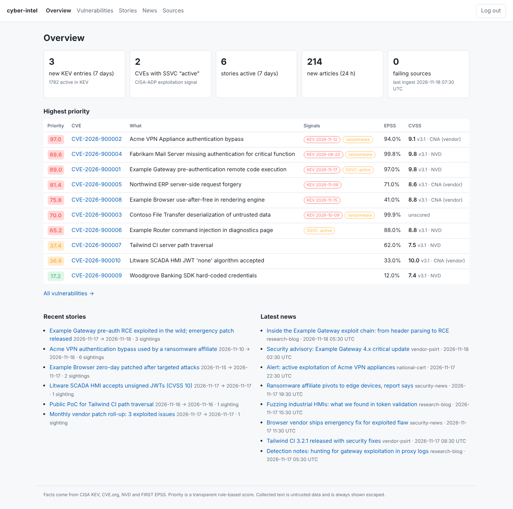
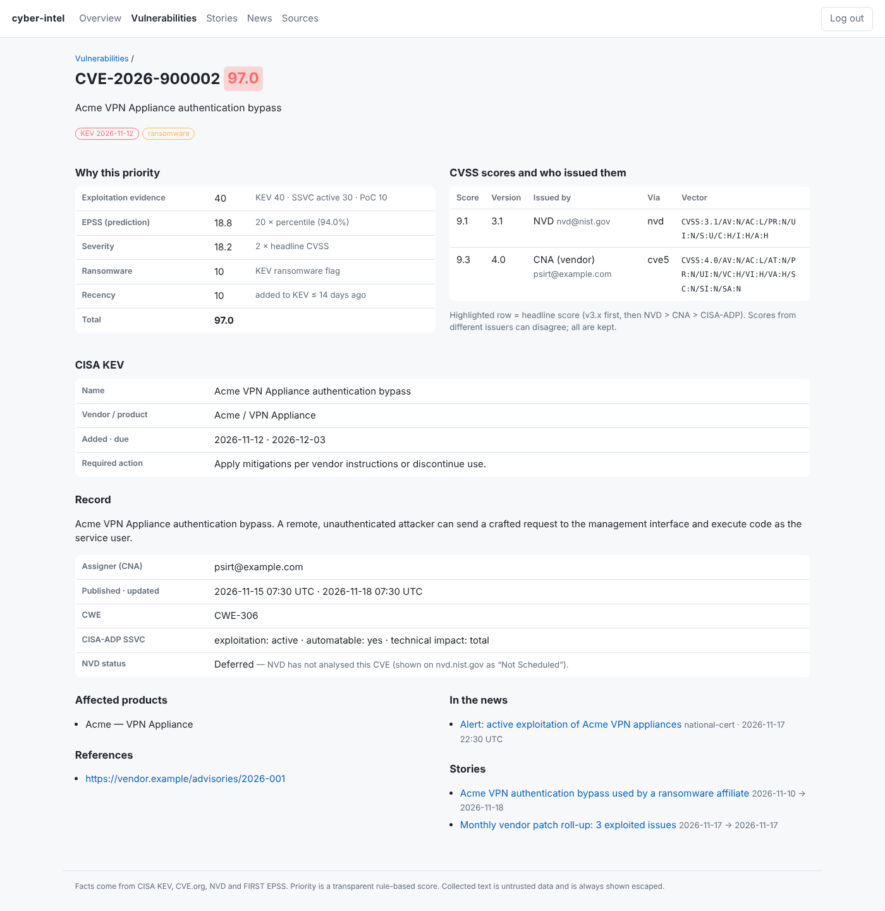
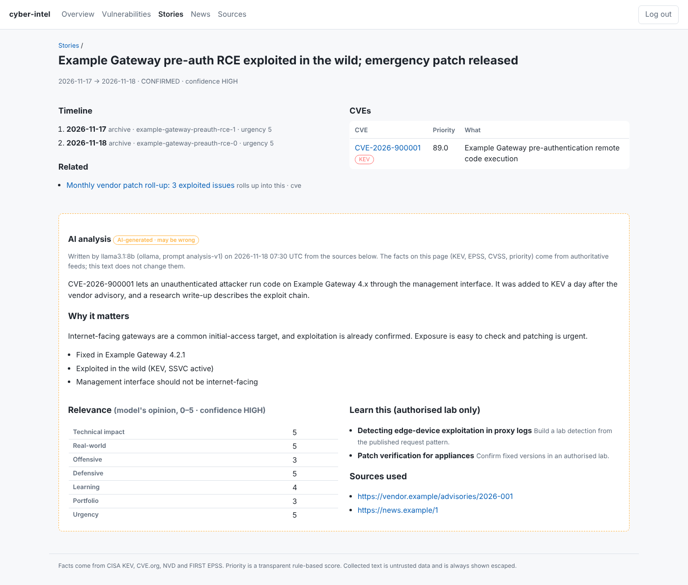
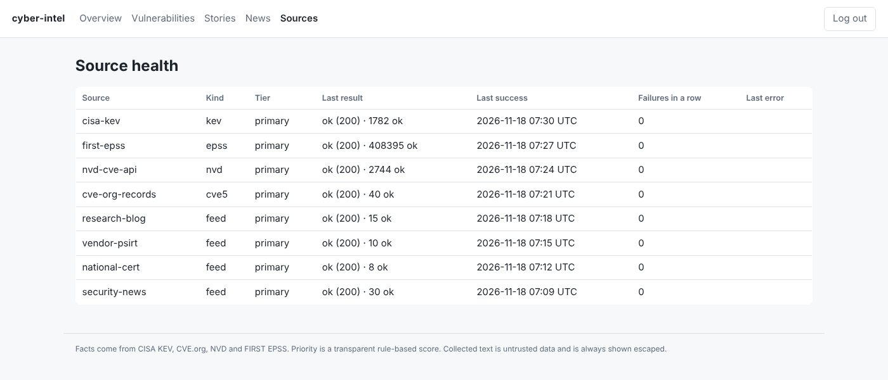

# WALKTHROUGH.md — a 10-minute tour

For reviewers, interviewers and future me: what this project is, the decisions that shaped it, and where to look to check each claim. Every screenshot uses the synthetic demo dataset (`tools/demo_reader.py`); none of it is real intelligence.

## 1. The problem

A security analyst moving into offensive security, AppSec, detection engineering and threat intelligence needs a daily, trustworthy view of what matters: which vulnerabilities are actually exploited, which stories are new versus the same incident re-reported, and what to learn from them. Two constraints made it interesting:

- **Facts must be facts.** Exploitation status, scores and dates come from authoritative feeds (CISA KEV, CVE.org, NVD, FIRST EPSS), never from a summariser.
- **Everything collected is hostile input.** Feeds and articles are attacker-reachable text: XXE, SSRF bait, XSS and prompt injection are in scope from day one.

## 2. The shape of the answer

Two halves (ARCHITECTURE ADR-001):

1. A **scheduled research agent** writes a daily brief into a private git archive (human-readable, already useful on day one).
2. This **platform** owns the facts: deterministic collectors, a PostgreSQL store with integrity rules, a dashboard, and an *optional* AI layer that may only comment.

The archive became the platform's test set: story-linking was designed and measured against nine days of real briefs (ENGINEERING_LOG, Phase 6/7).

## 3. Tour of the dashboard

**Overview.** What changed, ranked. The priority (0–100) is a transparent rule, not a model: KEV 40 / SSVC active 30 / PoC 10, plus EPSS percentile, CVSS, ransomware and recency.

**A vulnerability.** Every point of the priority is explained, and every CVSS score shows *who issued it* (NVD, the vendor CNA, CISA-ADP). After NVD's 2026 backlog change, scores from different issuers often disagree; the platform keeps all of them and states which one leads and why (SCORING.md).

**A story, with the optional AI panel.** Stories persist across days (one incident, many sightings) and link roll-ups without merging them. The AI note sits in a separate, dashed, labelled box under the facts, cites only collected sources, and never changes a fact.

**Source health.** Every fetch is audited; failing sources back off and are visible.

## 4. Five decisions worth asking about

| Decision | Why | Where to check |
|---|---|---|
| **SQL-first, integrity rules in the database** (facts never move backwards; a truncated KEV feed cannot mass-delete; NVD cannot overwrite CNA text) | Rules no caller can bypass, testable against real PostgreSQL | ADR-002; `store/migrations/`, `store/sql.py`; `tests/test_store_sql.py` |
| **Zero-JavaScript dashboard, CSP `default-src 'none'`** | A tool that renders attacker text should give a missed escape nowhere to run | ADR-003; `tests/test_web.py` parses every page for script elements, handlers and script URLs |
| **SSRF guard with pinned IPs; egress proxy generated from the source registry** | DNS rebinding and redirect tricks are the classic way past URL allowlists | `security/url_guard.py`, `net/fetch.py`, `deploy.py`; CI egress probe |
| **AI layer gated by containment, not trust** | Prompt injection can't be proven absent; mechanical output validation can be proven | ADR-004, AI.md; `tests/test_ai_containment.py`, `tests/test_ai_db.py` |
| **Least-privilege everything at deployment** | A compromise of one service should not become a compromise of the data | DEPLOYMENT.md; `store/grants.sql`; `tests/test_grants.py`, `tests/test_roles_e2e.py`; `.github/workflows/deploy.yml` |

## 5. How claims are verified

- **~600 tests**, including ~80 against real PostgreSQL 16, run on every pull request on Python 3.12 and 3.13; `mypy --strict`, ruff, pip-audit and gitleaks gate merges.
- **Mutation testing** throughout: each security check was disabled in turn to prove a test fails. The results, including the survivors that led to fixes, are in ENGINEERING_LOG.
- **Hostile fixtures:** XXE and billion-laughs feeds, SSRF via DNS to metadata/loopback/CGNAT, XSS through every page, a 29-document prompt-injection corpus with a malicious-model simulator.
- **The real stack in CI:** `deploy.yml` builds the images, brings up Compose, and probes from inside the containers: non-root, no capabilities, read-only root, egress allowlist (6 probes), database role denials, real KEV ingestion through the proxy, login, backup and restore.
- **Negative results are recorded**, e.g. a rejected title-similarity metric and three design changes forced by the first real-stack run (ENGINEERING_LOG, Phase 10).

## 6. Honest limits

- A plausible but wrong AI summary cannot be detected mechanically; it is contained (labelled, under the facts, sourced), not blocked (AI.md §3.2).
- In proxy mode the collector cannot pin IPs; the proxy's post-resolution deny takes over (THREAT_MODEL §6).
- Story linking is rule-based (CVE, title, rarity-weighted entities); no embeddings yet.
- Single-user by design: one password, VPN-only access.

## 7. Run it yourself

- Demo screenshots, no database: `python tools/screenshots.py` (needs Chrome + Playwright).
- Development: README "Run it (development)".
- Deployment: DEPLOYMENT.md (Proxmox, or VirtualBox in §9).
